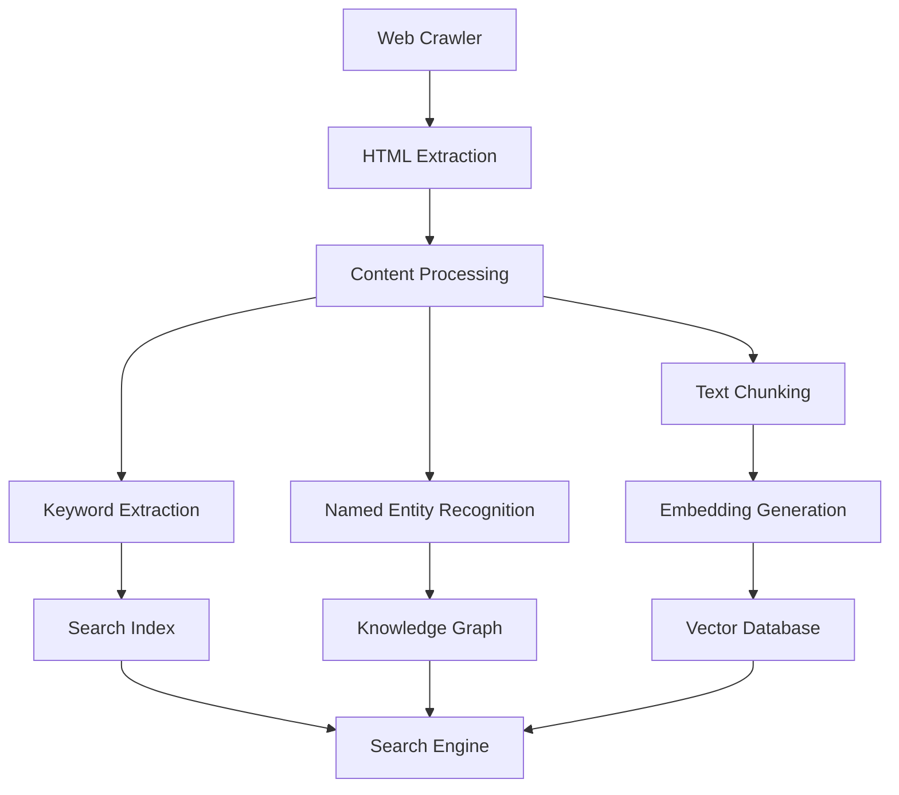

# moomle

**An educational search engine inspired by Google.**

moomle is an educational project exploring the architecture and technologies behind modern search engines. It aims to build a scalable search engine combining web crawling, information retrieval, semantic search, natural language processing, and knowledge graphs.

## Objectives

- Develop a scalable web crawler.
- Extract meaningful information from web pages.
- Implement traditional full-text search.
- Enable semantic search using vector embeddings.
- Extract keywords and named entities.
- Build a knowledge graph connecting pages, entities, and topics.
- Experiment with ranking algorithms and hybrid retrieval.

## Architecture

## Technology Stack

| Component | Technology | Purpose |
|---|---|---|
| Metadata storage | PostgreSQL | Page metadata and crawl state |
| Full-text search | OpenSearch | Inverted indexing and BM25 |
| Vector database | Milvus | Semantic similarity search |
| Graph database | ArangoDB | Knowledge graph and relationships |
| Event streaming | Apache Kafka | Distributed processing |
| Object storage | S3-compatible storage | Raw HTML and content archives |
| NLP | spaCy, Hugging Face | Entity recognition and text processing |
| Embeddings | BGE, Qwen Embedding, or similar | Semantic representations |

The technology stack may evolve throughout development.

## Core Features

### Web Crawling
- URL discovery and frontier management
- HTML and metadata extraction
- Link extraction and graph construction
- Robots.txt compliance
- Duplicate detection
- Crawl prioritization

### Information Extraction
- Main content extraction
- Keyword and keyphrase extraction
- Named entity recognition
- Entity linking
- Topic classification
- Structured data extraction

### Search and Indexing
- Full-text search using BM25
- Semantic search using embeddings
- Hybrid keyword and vector retrieval
- Search result ranking
- Passage-level retrieval

### Knowledge Graph
- Page-to-page relationships
- Entity-to-page relationships
- Topic associations
- Domain relationships
- Graph traversal and entity-based search

## Semantic Search

Pages will be represented using multiple semantic embeddings where appropriate:

- Title embeddings
- Description embeddings
- Main content embeddings
- Section-level embeddings
- Chunk embeddings

Long documents will be divided into meaningful chunks to improve retrieval precision.

## Hybrid Search

The search engine will combine multiple retrieval strategies:

1. BM25 for keyword matching.
2. Vector similarity for semantic retrieval.
3. Graph traversal for relationship-based discovery.
4. Ranking and reranking for final result selection.

## Development Roadmap

- [ ] Implement basic web crawler
- [ ] Implement HTML content extraction
- [ ] Build URL normalization and deduplication
- [ ] Integrate PostgreSQL
- [ ] Implement full-text indexing
- [ ] Integrate OpenSearch
- [ ] Implement keyword extraction
- [ ] Implement named entity recognition
- [ ] Build knowledge graph
- [ ] Integrate ArangoDB
- [ ] Implement embedding generation
- [ ] Integrate Milvus
- [ ] Implement hybrid search
- [ ] Develop ranking algorithms
- [ ] Build search API
- [ ] Develop search interface
- [ ] Optimize distributed crawling and indexing

## Educational Purpose

moomle is developed strictly for educational and research purposes.

The project aims to explore search engine architecture and underlying technologies rather than reproduce any proprietary search engine implementation.

Crawling activities will respect applicable website policies, robots.txt directives, and reasonable request rates.

## License

This project is licensed under the MIT License. See [LICENSE](LICENSE) for details.
